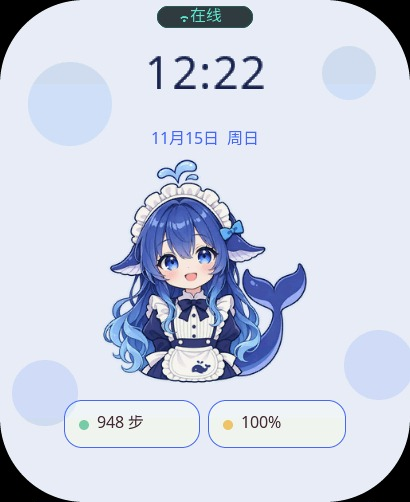
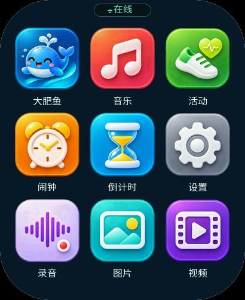
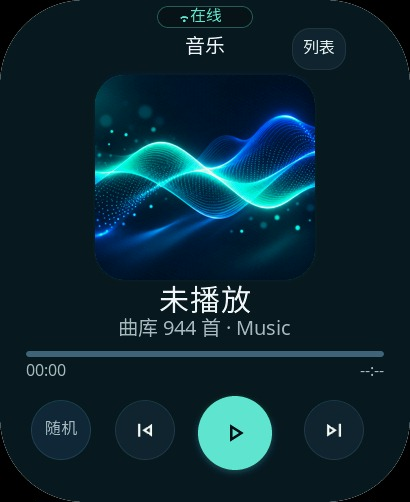
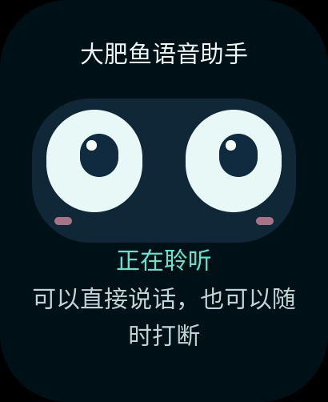
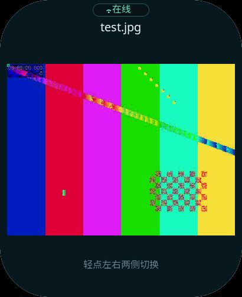
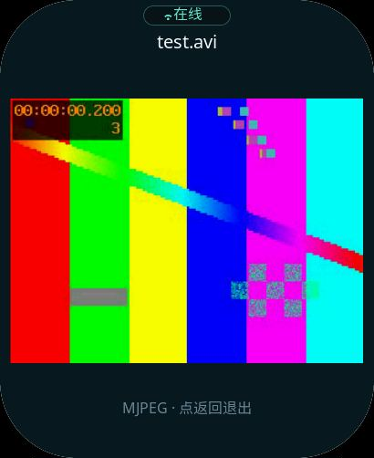

# WAVE AI Watch · 大肥鱼智能手表

> 把一块 **Waveshare ESP32-S3 2.06" AMOLED** 开发板，做成真正能戴在手上用的中文 AI 语音手表：
> 「你好大肥鱼」唤醒对话、TF 卡本地音乐、图片浏览、MJPEG 视频、语音备忘、计步、闹钟、AOD 息屏时钟——全部在手表上完成，不依赖手机。

<p align="left">
  
  
  
  
  
</p>

*A Chinese AI voice smartwatch firmware for the Waveshare ESP32-S3 2.06" AMOLED board: wake-word assistant, local music player, photo viewer, MJPEG video player, watch faces and an always-on clock — built on ESP-IDF 6.1 + LVGL 9.3.*

---

## 目录

- [实机截图](#实机截图)
- [能做什么](#能做什么)
- [和官方小智固件有什么不同](#和官方小智固件有什么不同)
- [硬件](#硬件)
- [快速开始](#快速开始)
- [TF 卡内容格式](#tf-卡内容格式)
- [媒体压缩工具](#媒体压缩工具)
- [唤醒词](#唤醒词)
- [系统架构](#系统架构)
- [调试与诊断](#调试与诊断)
- [已知限制](#已知限制)
- [路线图](#路线图)
- [许可与致谢](#许可与致谢)

## 实机截图

| 表盘 | 九宫格应用 | 音乐 |
|---|---|---|
|  |  |  |

| 语音助手 | 图片浏览 | 视频播放 |
|---|---|---|
|  |  |  |

## 能做什么

| 分类 | 功能 |
|---|---|
| **AI 语音** | 唤醒词「你好大肥鱼 / 嗨大肥鱼」进入对话；抬腕/BOOT 长按/点九宫格也能直接开始；上滑退出；实时字幕；支持 MCP 工具（`self.watch.*`：开应用、查状态、放音乐、设闹钟等） |
| **手表** | 三款中文表盘（鎏金雅韵、活力运动、经典指针）左右滑动切换；日期、步数、电量、在线状态；AOD 息屏时钟（黑底只显示时间/日期/电量） |
| **应用页** | 3×3 九宫格：大肥鱼、音乐、活动、闹钟、倒计时、设置、录音、图片、视频；图标为 108 px 抗锯齿素材 |
| **音乐** | 扫描 TF 卡 `/Music` 的 MP3/WAV（实测 944 首）；整列滚动 + 窗口懒加载，控件数量不随曲库增长；播放/暂停/上下曲/随机；支持语音"播放第 N 首"；助手误唤醒时自动暂停、回复后自动继续 |
| **录音** | 一键录音，16 kHz WAV 存 `/Recordings`；列表按时间排序，点按播放/停止 |
| **图片** | 全屏浏览 `/Photos` 的 JPG，超出解码预算自动 1/2、1/4 缩放；左右轻点切换 |
| **视频** | 播放 `/Video` 的 MJPEG 编码 AVI，按文件帧率逐帧软解到 PSRAM；**带 16 kHz 单声道 PCM 音轨时会同步播放声音** |
| **活动** | QMI8658 计步，环形目标进度 |
| **闹钟/倒计时** | 手表上设置，也能语音操作；闹钟到点唤醒 |
| **收款码** | 把微信/支付宝收款码图片放到 TF 卡 `/Payment`，对大肥鱼说「出示微信收款码」即可全屏展示给顾客扫码；支持按名称匹配（微信/支付宝/云闪付…） |
| **设置** | 表盘、亮度、音量、勿扰、WiFi、语音唤醒开关、关于本机 |
| **配网** | 应用 → 设置 → WiFi，直接扫描 2.4G 网络并用手表键盘输密码；也保留 AP + 网页配网兜底 |
| **自诊断** | 系统事件持久化到 TF 卡；开机记录复位原因、启动次数、内存水位；HTTP 接口读日志、看内存、截图、远程切页、上传/删除媒体 |

## 和官方小智固件有什么不同

| | 官方 xiaozhi-esp32 | 本项目 |
|---|---|---|
| 形态 | 开发板 / 通用设备 | 手表产品形态（410×502 圆角 AMOLED、AOD、触摸 + 双按键） |
| 界面 | 通用表情 + 文字 | 三款中文表盘、九宫格、助手眼睛浮层、字幕 |
| 媒体 | 无 | TF 卡音乐 / 图片 / MJPEG 视频 / 录音 |
| 配网 | AP 热点 + 手机网页 | 手表上直接选 WiFi 输密码 |
| 唤醒词 | 你好小智 | 你好大肥鱼 / 嗨大肥鱼（MultiNet 自定义，可换） |
| 调试 | 串口 | 串口 + HTTP 诊断（日志/内存/截图/远程切页）+ 桌面 UI 模拟器 |
| 配置 | 命令行 | 手表内设置页 + 浏览器配置中心 |

## 硬件

针对 **Waveshare ESP32-S3-Touch-AMOLED-2.06** 开发板：

| 部件 | 型号 |
|---|---|
| MCU | ESP32-S3R8，双核 240 MHz，**8 MB PSRAM（OPI）**，**16 MB Flash** |
| 屏幕 | 2.06" **410×502** AMOLED（QSPI，SH8601 兼容） |
| 触摸 | FT3168 电容触摸 |
| 电源 | AXP2101 PMIC（电量、充电、屏幕供电、PWR 键） |
| 运动 | QMI8658 六轴 IMU（计步） |
| 时钟 | PCF85063 RTC |
| 音频 | ES7210 双数字麦克风 ADC + ES8311 Codec |
| 存储 | TF（microSD）卡槽 |
| 按键 | BOOT（短按切换页面/长按语音）、PWR（短按 AOD 时钟，长按关机） |

> 其它板型也能移植：板级代码集中在 `firmware/xiaozhi-esp32/main/boards/waveshare/esp32-s3-touch-amoled-2.06/`，需要自行适配屏幕、PMIC、IMU 和按键。

## 快速开始

### 1. 准备环境

- [ESP-IDF 6.1](https://docs.espressif.com/projects/esp-idf/)（`git clone -b v6.1 --recursive` 后 `source export.sh`）
- Python 3、macOS 或 Linux
- 能传数据的 USB-C 线（USB-Serial-JTAG）
- 首次编译会自动拉取 `managed_components/`（约 700 MB，已在 `.gitignore`），需要能访问 GitHub

### 2. 编译

```sh
cd firmware/xiaozhi-esp32
source /path/to/esp-idf/export.sh
python3 scripts/build.py waveshare/esp32-s3-touch-amoled-2.06 \
    --name esp32-s3-touch-amoled-2.06 --language zh-CN --wake-word custom
```

`--wake-word custom` 使用 `config.json` 里配置的两条自定义唤醒词（MultiNet 中文模型），其它可选值见 `scripts/build.py`。
产物：`build/xiaozhi.bin`（应用）、`build/assets.bin`（8 MB 资源分区：字体/表情/唤醒模型）。

### 3. 烧录

```sh
cd build
source /path/to/esp-idf/export.sh
python -m esptool --chip esp32s3 -p /dev/cu.usbmodem2101 -b 921600 \
    --before default-reset --after hard-reset write-flash @flash_args
```

> ⚠️ **不要**用 `merged-binary.bin @0x0` 整片烧录：合并镜像会用 0xFF 覆盖 `0x9000` 起的 NVS 分区，导致 WiFi 密码、表盘、亮度、闹钟全部丢失。`@flash_args` 按分区逐镜像写入，保留 NVS。

### 4. 首次配置

1. 开机等约 6 秒进入表盘；
2. 应用 → 设置 → WiFi，扫描并输入密码（仅 2.4 GHz）；
3. 说「你好大肥鱼」或「嗨大肥鱼」，看到眼睛浮层即可对话；
4. 插卡，把音乐/照片/视频按下面格式放进对应目录。

默认语音服务走小智官方云（`https://api.tenclass.net/xiaozhi/ota/`）。要自建可用 [xiaozhi-esp32-server](https://github.com/xinnan-tech/xiaozhi-esp32-server)，把 `config.json` 的 OTA 地址改成自己的服务端后重新编译烧录。

## TF 卡内容格式

```text
/Music       音乐：.mp3 / .wav
/Photos      图片：.jpg（baseline JPEG，像素数 ≤ 240,000，如 480×500 / 640×375）
/Video       视频：.avi（MJPEG 编码，≤ 320×240，12~15 fps，可带 16 kHz 单声道 PCM 音轨）
/Recordings  语音备忘：.wav（16 kHz，手表自己生成）
/Payment     收款码：.jpg（baseline，建议 ≤384×384，文件名即叫法：微信.jpg / 支付宝.jpg）
```

固件是硬限制，格式不对会显示"无法播放"：

| 媒体 | 关键要求 | 原因 |
|---|---|---|
| 照片 | **baseline JPEG**（不能 progressive）、像素数 ≤ 240,000、方向已摆正 | 解码缓冲 480 KB ÷ 2 字节/像素；固件不读 EXIF |
| 视频 | **MJPEG 编码的 AVI**、≤ 320×240、12~15 fps；音轨只支持 **16 kHz 单声道 16-bit PCM** | ESP32-S3 无 H.264 硬解；音频走 ES8311，PCM 最省事 |

手写 ffmpeg 转换命令：

```sh
# 照片：缩到 480 盒内 + 标准 4:2:0 baseline JPEG
ffmpeg -i in.jpg -vf "scale=480:480:force_original_aspect_ratio=decrease,format=yuvj420p" -q:v 4 out.jpg

# 视频：320×240 以内、15fps、MJPEG + 16kHz 单声道 PCM 音轨
ffmpeg -i in.mp4 -vf "scale=320:240:force_original_aspect_ratio=decrease,fps=15" \
       -c:v mjpeg -q:v 7 -pix_fmt yuvj420p -c:a pcm_s16le -ar 16000 -ac 1 -f avi out.avi
```

## 媒体压缩工具

[`tools/watch-media-converter`](tools/watch-media-converter/README.md) 是配套的批量压缩工具（原生 macOS App + 命令行，依赖 `ffmpeg`）：

- 双击 `WAVE 媒体压缩.app`（`app/build-app.sh` 构建，拖放文件夹即可）；
- 照片 → baseline JPEG（≤ 240,000 像素，自动摆正方向、HEIC 支持）；
- 视频 → MJPEG AVI（320×240 / 15 fps / 保留 16 kHz 单声道 PCM 音轨）；
- 输出直接生成 `Photos/` 和 `Video/` 两个目录，拷到 TF 卡根目录即可。

实测：20 张 3024×4032 照片 + 30 秒 1080p 视频 → 合计 **1.1 MB**，6 秒转完。

## 收款码（AI 出示）

1. 把收款码图片（微信/支付宝的收款码截图即可）放 `TF 卡/Payment/`，**文件名就是它在手表里的叫法**：
   `微信.jpg`、`支付宝.jpg`、`云闪付.jpg`（也认 `wechat.jpg` / `alipay.jpg`）。
2. 对大肥鱼说「把收款码给我看看」「出示微信收款码」，助手会调用手表工具 `self.watch.pay.show`，屏幕全屏显示收款码，顾客扫码即可；点返回或说「关闭」退出。
3. 可用工具：`self.watch.pay.show`（参数 `code` 可选）、`self.watch.pay.list`（列出已有收款码）。
4. 生成图片：用 [`tools/watch-media-converter`](tools/watch-media-converter/README.md) 勾选「收款码模式」，输出会放到 `Payment/`（384px、baseline JPEG），整个文件夹拷到卡上即可。

> 建议图片 ≤384×384、白底、不要压缩太狠（App 默认质量优先）；手表按 1:1 像素显示，扫码枪和手机都能识别。

## 唤醒词

默认唤醒词 **你好大肥鱼**（`ni hao da fei yu`）和 **嗨大肥鱼**（`hai da fei yu`），使用 ESP-SR MultiNet 中文模型（`mn7_cn`），不再加载"你好小智"的 WakeNet 模型。

- 配置在 `firmware/xiaozhi-esp32/main/boards/waveshare/esp32-s3-touch-amoled-2.06/config.json`：
  `CONFIG_CUSTOM_WAKE_WORD` / `..._DISPLAY` / `CONFIG_CUSTOM_WAKE_WORD_ALT` / `..._ALT_DISPLAY` / `CONFIG_CUSTOM_WAKE_WORD_THRESHOLD`
- 阈值默认 25（越小越灵敏）：误唤醒多调到 35~40，喊不动调到 15~20。
- 唤醒词命中时如果正在放歌，会先暂停、对话结束后自动继续（不会把歌停掉）。

## 系统架构

```text
┌───────────────────────────────────────────────────────────┐
│ 应用层   Application（小智协议状态机 / MCP / 语音通道）      │
├───────────────────────────────────────────────────────────┤
│ UI 层    CustomLcdDisplay（LVGL 9.3）                      │
│          表盘 · 九宫格 · 音乐 · 活动 · 闹钟 · 倒计时         │
│          设置 · 录音 · 图片 · 视频 · 助手浮层 · AOD          │
├───────────────────────────────────────────────────────────┤
│ 服务层   WatchActivityService  计步（QMI8658）              │
│          WatchAlarmService     闹钟/倒计时（RTC + NVS）      │
│          WatchConfigService    HTTP 设置接口（端口 80）      │
│          WatchDebugServer      诊断接口（端口 8080）         │
│          WatchMusicPlayer      MP3/WAV + SD 曲库            │
│          WatchMedia            JPEG / MJPEG AVI 解码        │
│          WatchFonts            自定义字库加载               │
├───────────────────────────────────────────────────────────┤
│ 平台层   AudioService（AFE/AEC、ES8311/ES7210）             │
│          Board/WifiBoard（网络、配网、OTA）                  │
│          esp_lcd + SH8601（QSPI AMOLED）                    │
└───────────────────────────────────────────────────────────┘
```

仓库结构：

```text
firmware/xiaozhi-esp32/      固件（ESP-IDF 工程）
  main/boards/waveshare/esp32-s3-touch-amoled-2.06/   板级 UI 与服务（核心）
  main/watch_music_player.*  全局音乐播放器
  scripts/build.py           构建封装（板型/语言/唤醒词）
host-sim/                    桌面 UI 模拟器（从固件源码抽取界面类，LVGL + SDL）
config-portal/               浏览器配置中心（Node.js）
tools/watch-media-converter/ 照片/视频批量压缩工具（原生 macOS App + CLI，ffmpeg）
assets/app-icons/            九宫格图标源文件（透明 PNG）
assets/whale-girl.png        表盘鲸鱼插画源文件
scripts/                     图标/插画生成、串口日志抓取
docs/                        架构、产品方案、路线图与实机截图
```

### 关键内存约束

- ESP32-S3 有 512 KB 内部 SRAM；MultiNet 唤醒词 + WiFi + LVGL 刷新缓冲 + 音频后，**内部 SRAM 常态只剩约 65~70 KB**（最大连续块约 24 KB）。
- 因此全部大缓冲都在 PSRAM：LVGL 内存池（1 MB）、图片/视频解码缓冲、视频解码任务栈、唤醒词缓存、表盘插画。
- 图片解码工作缓冲（65 KB）也不能从内部 RAM 申请——否则解码瞬间内部 SRAM 见底。
- 应用分区 4 MB 目前占用约 **94%**（约 220 KB 余量）：图标用 108 px RGB565A8，表盘插画/音乐波形用 JPEG 存 flash、开机解码到 PSRAM。

## 调试与诊断

### 串口日志

```sh
python3 scripts/watch_serial_log.py -p /dev/cu.usbmodem2101 -o /tmp/watch-serial.log
```

断线自动重连，panic 会保留完整 backtrace。

### HTTP 诊断接口（端口 8080）

| 接口 | 鉴权 | 说明 |
|---|---|---|
| `GET /log`、`/log.1` | 无 | TF 卡上的系统事件日志（开机原因、WiFi、音乐扫描、页面切换等） |
| `GET /info` | 无 | 版本、运行时间、复位原因、启动次数、状态、内存、WiFi、曲库 |
| `GET /mem` | 无 | 内部 SRAM / PSRAM 的空闲、最大块、最低水位 |
| `GET /screen?t=<token>` | token | 当前界面 JPEG 截图 |
| `GET /nav?t=<token>&page=<名称>` | token | 远程切页（如 `应用`、`音乐`、`photo:0`、`video:0`、`播放音乐`） |
| `GET /file?t=<token>&path=<路径>` | token | 读回 TF 卡文件 |
| `POST /upload?t=<token>&path=Photos/x.jpg` | token | 上传文件到 TF 卡（仅 `Photos/`、`Video/`） |
| `POST /delete?t=<token>&path=<路径>` | token | 删除 TF 卡文件（仅 `Photos/`、`Video/`） |

`<token>` 每次启动随机生成，打印在串口和 `/log` 的 `debug token` 行里，仅供本地调试。

### 桌面 UI 模拟器

```sh
cd host-sim
./run.sh
```

`extract_watch_ui.py` 会从固件板级源码里抽取 `CustomLcdDisplay` 类，在 macOS 上用 LVGL + SDL 渲染**同一份界面代码**——改 UI 可以先在电脑上看效果。

## 已知限制

- **语音依赖云端**：对话走小智协议（默认官方云），断网只能用本地功能。
- **视频音频格式**：只支持 16 kHz 单声道 16-bit PCM 音轨（转换工具默认就是这个）。
- **图片仅 JPG**：不支持 PNG/HEIC（用压缩工具转换）。
- **视频仅 MJPEG**：ESP32-S3 没有 H.264 硬解。
- **内部 SRAM 紧张**：新功能请避免在内部 RAM 分配大缓冲，见上文。
- **固件空间**：应用分区约 94% 占用，加资源前先评估。
- **配网**：仅 2.4 GHz WiFi。
- **偶发开机卡住**：极少数情况下激活阶段（OTA/MQTT 连接）会卡住，PWR 长按重启即可；后续会加超时兜底。

## 路线图

- [ ] 图片缩略图列表 + PNG 支持
- [ ] 音乐 ID3 标签、封面、播放列表、锁屏后台播放
- [ ] AOD 真正低功耗（息屏停麦/停唤醒词 + 轻睡眠）
- [ ] 激活阶段超时兜底，避免偶发卡住
- [ ] 板级文件拆分（`watch_ui/`、`apps/`、`services/`）
- [ ] 自建语音服务端一键部署脚本
- [ ] 英文界面（i18n）
- [ ] CI：host-sim 构建 + 固件编译 + Release 产物

## 许可与致谢

本项目代码采用 **MIT License**，见 [LICENSE](LICENSE)。

基于以下开源项目：

- [78/xiaozhi-esp32](https://github.com/78/xiaozhi-esp32) — 小智 AI 固件框架（MIT），本项目在其上做手表化改造
- [LVGL](https://github.com/lvgl/lvgl) — 图形库（MIT）
- [xiaozhi-esp32-server](https://github.com/xinnan-tech/xiaozhi-esp32-server) — 可选自建服务端
- Espressif ESP-IDF、ESP-SR（MultiNet）、`esp_jpeg`、`esp_new_jpeg`

语音数据默认发送到小智官方服务器；自建服务端时数据只经过你自己的服务器。

---

**免责声明**：个人项目，按现状提供，不保证稳定。刷机有风险，请先备份 NVS 与原始固件。
