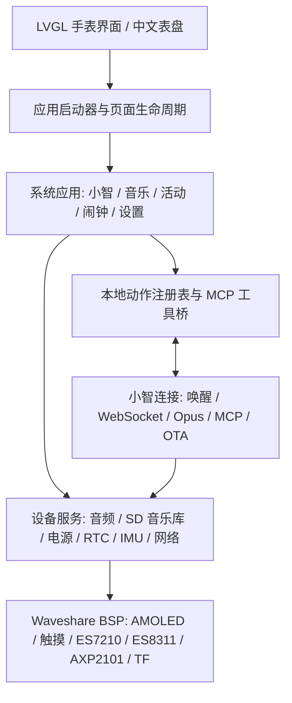

# WAVE Watch 系统架构

本项目将产品界面、设备应用和小智语音能力整合为一套手表固件。当前浏览器模拟器用于验证交互与中文视觉；正式固件以小智官方 ESP-IDF 固件及其 Waveshare 2.06 板级支持为底座。

## 设备分层

## 关键约束

- 小智负责语音会话、云端模型接入、设备发现和 MCP 传输；手表固件负责执行有明确边界的本机动作。
- Waveshare 2.06 官方 target 配置启用 device AEC，并将编解码器标为有输入参考；小智在 AEC 开启时选择 realtime listening mode。此配置让固件走持续采集/播报并行路径，声学效果和插话成功率仍需实体设备验证。
- MCP 工具由应用按能力注册。例如音乐应用未启动或 SD 卡未挂载时，不向模型报告音乐操作可用。
- 音乐和语音共用 ES8311 输出；当前首版在语音会话期间暂停音乐、回到待机后继续，并通过 AudioService 的共用输出队列写入音频。
- 全双工必须维持上行麦克风与下行播放并行，并通过 AEC 解决扬声器回声。双麦克风本身不代表已有可用的播放参考回声消除链路。
- TF 卡是本地音乐媒体源；容量、文件系统、热插拔和实际引脚/驱动以随板官方 BSP 与真机验证为准。
- ESP32-S3 运行的是嵌入式应用框架，不是 Android。所谓“AI 控制应用”指控制本固件内已注册的系统应用和设备能力，不允许模型运行任意代码。

## 当前固件落地

- `firmware/xiaozhi-esp32` 固定在官方 XiaoZhi commit `2aed8049eaf02db0377928c472d2132733b82a52`，复用其 Waveshare 2.06 板级适配、音频服务和 MCP 服务。
- 目标板 LVGL 层已有触摸桌面、三款中文表盘切换、应用页、亮度/音量设置、勿扰开关、SD 音乐页、活动页、倒计时和每日闹钟页。表盘、勿扰状态、活动目标和闹钟设置保存在 NVS；`self.watch.system.status` 可查询时间、电量、语音/AEC 状态和音乐/计时器/闹钟状态；`self.watch.face.*`、`self.watch.app.*`、`self.watch.activity.*`、`self.watch.timer.*`、`self.watch.alarm.*` 和 `self.watch.settings.*` 可由小智 MCP 调用。亮度、音量可查询和调整，勿扰模式可查询和切换；开启后倒计时或闹钟到期仍显示提醒，但不播放提示音。系统时区在板级启动时设为中国标准时间 UTC+8。每日闹钟每 10 秒检查一次，只在固件运行期间触发，不负责从关机或深度睡眠唤醒；时钟供时和唤醒能力仍需真机验证。活动计步服务按该板 QMI8658 内置计步器初始化；因当前没有实体板，传感器配置与计步精度仍待验证。
- 目标板 LVGL 显示类已加入中文双眼助手浮层：聆听/连接/回答状态切换显示，`SetChatMessage` 更新字幕，回答期间提高眼睛动画频率。它依赖运行时可用的中文字体；桌面模拟器不运行这份板级 C++ 代码。
- `main/watch_music_player.*` 通过板载 SDMMC 1-bit 引脚挂载 FAT，只索引卡根目录下的 `/sdcard/Music`（FAT 不区分大小写，`music`、`MUSIC` 同样命中）及其内部三层子目录；卡上不是这个目录名就一首都不收录，卡根目录和其它目录永不被遍历，录音、日志和备份不会被当成歌曲；若卡上仍是旧的 `音乐` 目录，首次扫描会直接 `rename()` 成 `Music`（仅当 `Music` 不存在时动作，改名失败才退回扫描旧目录）。板级 `config.json` 为板型启用 `CONFIG_FATFS_API_ENCODING_UTF_8`，否则 FAT 长文件名里的中文会被 OEM 代码页替换成 `_`：`Music` 目录本身是 ASCII 不受影响，但中文歌名会显示和打开失败。扫描结果的曲库数量与索引目录写入 `/sdcard/logs/system.log` 的 `music scan_finished` 行，音乐页同样显示 `曲库 N 首 · 目录名`。
- `main/watch_music_player.*` 索引 MP3/WAV 曲目；AI 搜索结果带稳定路径哈希编号，歌名命中多首时先返回候选项，确认后可按 `track_id` 播放。播放、暂停、切歌和停止由 `self.watch.music.*` MCP 工具完成，语音会话期间自动暂停并在待机后恢复。`watch_alarm_service.*` 持久化每日闹钟，并通过 `self.watch.alarm.*` 工具设置、查询和关闭。
- 解码后的 16-bit PCM 进入 `AudioService` 现有的有界播放队列，由同一 codec/I2S 输出任务写入 ES8311，避免并行 I2S 写入。音乐 PCM 使用独立源编号和代次，停止或切歌时清除旧代次的待播块，不影响小智语音队列；已开始写入 codec 的单个音频块无法被软件撤回。
- 应用页是 3×3 九宫格，图标由 `scripts/app_icons_from_png.py` 从 `assets/app-icons/*.png` 生成（92×92、RGB565、透明角烘焙成页面底色），表盘插画/音乐波形由 `scripts/png_to_jpeg_asset.py` 转 JPEG 存 flash、开机解码到 PSRAM；`scripts/png_to_app_icons.py` 保留作为从图标表切图的备用方案。`watch_media.*` 提供 TF 卡媒体：照片扫描 `/sdcard/Photos`（回退 Pictures/DCIM），用 TJpgDec 解码并按输出体积自动 1/2·1/4·1/8 缩放；视频扫描 `/sdcard/Video`（回退 Movies），解析 MJPEG-in-AVI 的 `movi` 块，用 esp_new_jpeg 逐帧解码到 16 字节对齐的 PSRAM 缓冲，按 AVI 帧率投到 LVGL 图片；不支持音轨。
- `main/watch_voice_memo.*` 把麦克风 PCM 写成 `/sdcard/Recordings/memo_YYYYMMDD_HHMMSS.wav`（16 kHz 单声道 16-bit），录音期间由 AudioService 独占输入；`ListRecordings()` 枚举录音并读 WAV 头算时长，备忘录页据此显示列表。录音回放复用 `WatchMusicPlayer::PlayFilePath()`：它绕开曲库索引、播完即停，PCM 走同一条输出队列和音乐源。
- 板载音乐页显示曲库数量和当前曲目；「列表」页是一个整体滚动的懒加载列表，任何时刻只有 72 行在 LVGL 里，滑动到距边缘 12 行时按 100 ms 轮询预加载下一段窗口，并保持当前可见行不动，944 首也不会一次性创建 944 个控件；语音 MCP 搜索覆盖完整索引曲库。扫描读取 MP3 的 ID3v2.2/2.3/2.4 标题、歌手、专辑和 TLEN 时长，WAV 时长从 RIFF 数据块读取；搜索匹配标签和文件路径。进度位置按解码采样累计，MP3 缺少 TLEN 时按可用码率估算时长；精确输出位置、VBR 曲目时长和队列延迟尚未实机校准。触屏端文本搜索和队列编辑仍待实现。倒计时应用支持 1 秒至 24 小时、状态查询、取消和结束提示；每日闹钟按已同步的系统时间运行，关机/深度睡眠唤醒和 RTC 供时仍待确认，音乐音量 ducking 尚未接入。Waveshare 2.06 固件已使用 ESP-IDF 6.1、`zh-CN` 和 `nihaoxiaozhi` 成功构建，合并烧录包约 11 MB，应用分区余量约 18%。固件尚未烧录到实体设备，因此真实持续上行、AEC、插话、QMI8658 初始化、SD 引脚和屏幕触摸仍未验证。

详细产品范围、应用清单、MCP 工具和开发里程碑见 [PROJECT_PLAN.md](PROJECT_PLAN.md)。
