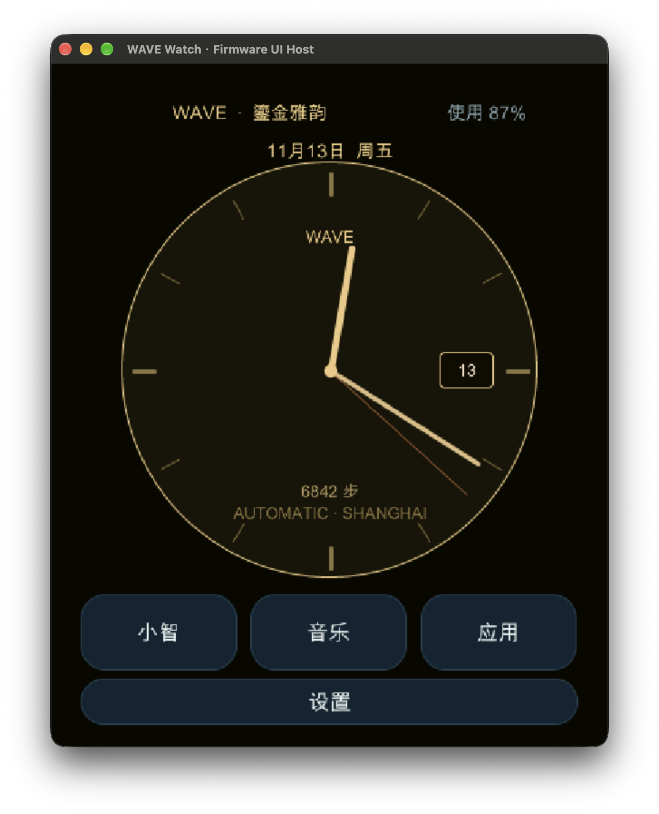
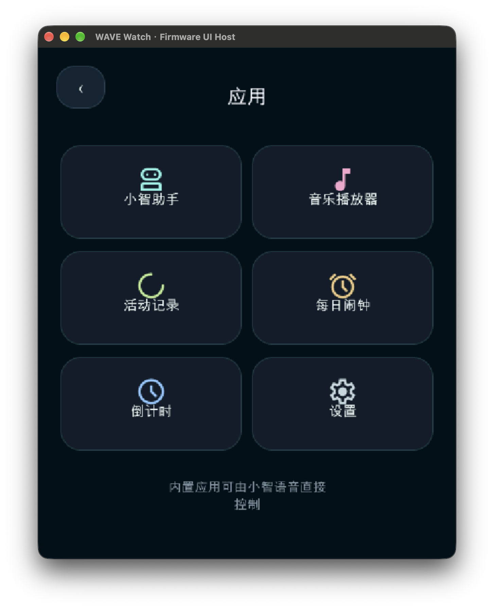

# Firmware UI Host Harness

这是 B 路线的第一块：把固件板级文件里的 **`CustomLcdDisplay` 类原样抽取**出来，用 macOS 上的 LVGL + SDL 跑同一份界面代码，而不是重新画一遍。

## 当前状态

- **三款表盘已重做**：
  - 鎏金雅韵：深色圆形机械表盘、12 个金色刻度、三针、日期窗、步数副显示。
  - 活力运动：大号数字时间 + 三层活动/电量/目标圆环。
  - 经典指针：米白表盘、罗马数字、日期窗、小秒盘。
- **应用启动页已加图标**：小智、音乐、活动、闹钟、倒计时、设置都使用 Material Symbols 图标 tile。
- **字号层级已修**：`WatchLabel` 现在把 30px 基础字体按目标字号做 `transform_scale`，不再是所有文字同一大小。
- 固件 `idf.py build` 已通过；host 与固件共用抽取出来的 UI 类。





## 证明它跑的是真实 UI 代码

`extract_watch_ui.py` 在构建时从下面这个板级文件提取 `CustomLcdDisplay` 整个类：

```text
firmware/xiaozhi-esp32/main/boards/waveshare/esp32-s3-touch-amoled-2.06/esp32-s3-touch-amoled-2.06.cc
```

host **不复制页面、不重画按钮**；表盘、页面、返回、助手浮层、按钮事件都来自这份代码。固件改 UI，重新构建 host 就会同步。

## 仍然 mock 的部分

`Board`、`AudioCodec`、`Backlight`、`Settings`、`WatchActivityService`、`WatchTimerService`、`WatchAlarmService`、`WatchMusicPlayer` 是 host shim：

- 不模拟 ESP32-S3 CPU/PSRAM、AMOLED QSPI、触摸驱动、ES8311/ES7210、真实音频/AEC、SD 卡解码、IMU、RTC、功耗、Wi-Fi/MCP。
- 因此它是 **firmware UI host harness**，不是 QEMU，也不是完整固件。
- 音乐播放是状态/进度模拟，不会出声；闹钟/倒计时用宿主计时器，不会真正震动/响铃。

## Build / run

需要 macOS、CMake、SDL2、Python3。首次配置会下载 LVGL 9.3.0；如果固件的 ESP-IDF managed component 尚未下载，CMake 也会自动获取锁定版本的 Material Symbols 字体资源：

```sh
cd host-sim
cmake -S . -B build
cmake --build build -j4
./build/watch-host
```

如果本机已有 LVGL 源码：

```sh
cmake -S . -B build -DFETCHCONTENT_SOURCE_DIR_LVGL=/path/to/lvgl-9.3.0
```

也可以直接：

```sh
./run.sh
```

## 启动参数 / 快捷键

```sh
./build/watch-host --face=2 --page=music
./build/watch-host --assistant
```

- `--face=1|2|3`：鎏金雅韵 / 活力运动 / 经典指针。
- `--page=music|activity|timer|alarm|apps|settings`：启动后打开指定页面。
- `--assistant`：直接显示小智聆听浮层。
- 键盘：`1/2/3` 切表盘，`m/a/t/l/p/s` 打开页面，`v` 在 待机 → 聆听 → 回答 → 待机 之间切换，`q` 退出。
- 鼠标：窗口获得焦点后可点击所有按钮、返回、滑块和表盘。

窗口默认 1.5× 缩放，实际 LVGL 分辨率仍是 410 × 502。

## 字体

host 默认用 30px 基础字体，由 `WatchLabel` 缩放到目标光学字号（约 12–45px）。`WAVE_HOST_FONT_SIZE` 可以改基础字号：

```sh
WAVE_HOST_FONT_SIZE=20 ./build/watch-host
```

设置 `30` 更接近固件的 30px CBIN 主题字体；设置 `20` 可以看更宽松的宿主预览。两者都只影响 host，不会改固件资产。

**真机字库**：固件随附的 `font_noto_sans_common_30_4` 不含“鎏”字形，所以固件界面把该表盘显示为“金色雅韵”；语音切换仍接受“鎏金雅韵”别名。其它两款表盘名称不变。host 使用系统 Arial Unicode，因此继续显示设计名“鎏金雅韵”。

## Scope / next

当前 host harness 验证的是 **UI 代码本身**：布局、页面生命周期、LVGL 对象、字号、按钮事件、表盘和助手浮层。下一阶段才是把服务层也换成真实实现：

1. 抽 `Board`/`AudioCodec`/`Backlight` 接口，接入真实 `AudioService` 的 host 版；
2. 把 `WatchTimerService`/`WatchAlarmService` 换成固件实现；
3. 接入 MCP 命令和真实音频时，再考虑 QEMU 或 USB 设备在环。
